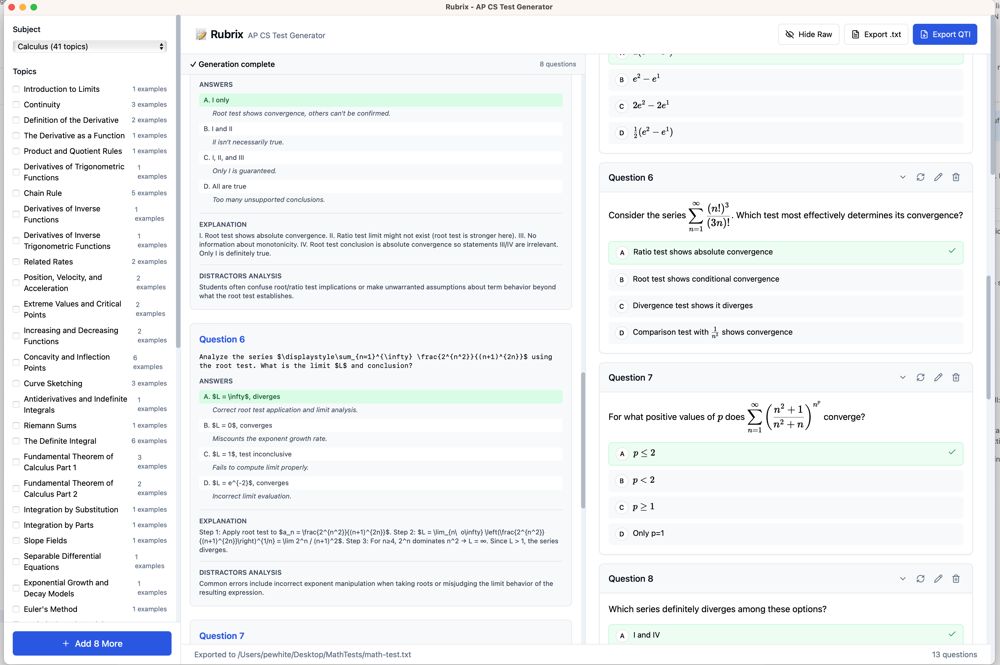

# Catie

**Generate AP-style multiple-choice questions in minutes with AI**

Catie is a desktop application that helps teachers create multiple-choice questions for AP Computer Science A and Calculus. It generates questions with proper code blocks and mathematical notation, lets you edit and regenerate them, and exports to your LMS or Word.

## Key Features

**Subjects, topics and subtopics**
- AP Computer Science A and Calculus
- Pick topics and nested subtopics from curated knowledge banks

**Generation**
- Easy, Medium or Hard difficulty
- 1-8 questions per run, appended to the current document
- Optional instructions to guide the AI
- Live streaming preview

**Math and code**
- KaTeX rendering for inline `$f'(x)$` and display math
- Syntax-highlighted Java code and Markdown tables

**Editing**
- Edit questions, answers and explanations
- Regenerate a single question (with optional instructions) or all questions
- Add your own custom questions
- View the raw model output for any question

**Documents**
- Tabs, Save/Open, Open Recent
- Preferences for default subject and difficulty

**Export**
- QTI (`.imscc`) for Schoology, Canvas and other LMSs
- Markdown
- Word (`.docx`), including multiple versions

**Bank Editor**
- Edit the per-subject question banks used as examples for the AI

## Quick Start

1. **[Download Catie](https://github.com/paderevski/rubrix/releases/latest)** for your platform
2. **Install** it ([install notes](release-build-readme.md))
3. **Log in** with the username and password provided to you when you first generate
4. **Generate** - choose topics, difficulty and count
5. **Export** - QTI, Markdown or Word

---

**[Get Started →](getting-started.md)** | **[User Guide →](user-guide.md)** | **[FAQ →](faq.md)** | **[Changelog →](https://github.com/paderevski/rubrix/blob/main/CHANGELOG.md)**

---

## Access

Generation runs through a hosted gateway to AWS Bedrock, so you need an account created by the project administrator. You do not need an AWS or AI-provider key.

---

<small>Built by teachers, for teachers. Questions or feedback? Use **Help → Submit Bug** in the app or [open an issue](https://github.com/paderevski/rubrix/issues) on GitHub.</small>
